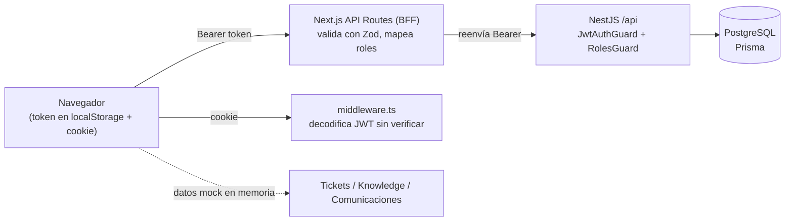
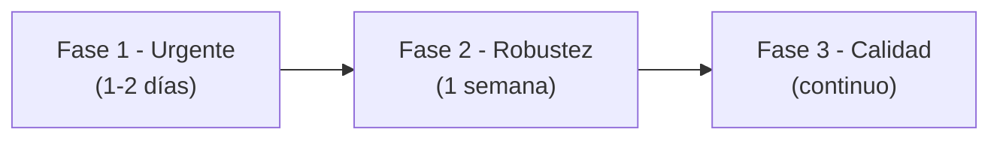

# Análisis integral — LTGTSYSTEM

**Stack:** NestJS 10 + Prisma 5 + PostgreSQL 16 (backend) · Next.js 14.2.25 App Router + React Query + Zod + shadcn/ui (frontend) · Docker Compose.
**Alcance revisado:** todo el código versionado (`backend/src`, `prisma`, `frontend/app`, `frontend/lib`, `contexts`, `middleware`, Dockerfiles, compose). Verificado con `tsc --noEmit` en ambos proyectos.

---

## 1. Resumen ejecutivo

| Área | Estado | Comentario |
|---|---|---|
| Backend | 🟡 Aceptable | Estructura modular limpia, DTOs + ValidationPipe, bcrypt, guards por rol. Faltan: manejo de errores Prisma, validación en update de usuarios, transacciones, tests. |
| Frontend | 🟡 Aceptable | Buena separación (BFF, schemas Zod, queries, permisos). Mucho código duplicado en el BFF, módulos Tickets/Knowledge/Comunicaciones son **mock**, errores de TS ocultos. |
| Arquitectura | 🟠 Mejorable | El patrón BFF está a medias (el token sigue en el navegador). **El Dockerfile de producción del frontend no funciona** (Nginx no puede ejecutar Next.js). |
| Seguridad | 🟠 Mejorable | Sin hallazgos críticos explotables por anónimos, pero: JWT en `localStorage` + cookie no-HttpOnly, rol leído sin verificar firma, sin rate limit, Swagger público, credenciales por defecto. |

### Top 10 prioridades

| # | Severidad | Hallazgo | Ubicación |
|---|---|---|---|
| 1 | 🔴 Alta | Dockerfile frontend sirve `.next` con Nginx → API routes, middleware y SSR **no funcionan** en prod | [Dockerfile](file:///home/alejandro/Proyectos_Decimo/LTGTSYSTEM/frontend/Dockerfile) |
| 2 | 🔴 Alta | `PATCH /users/update/:id` sin DTO → **mass assignment** (se puede escribir `password` en texto plano, `email`, etc.) | [users.controller.ts:L60-L62](file:///home/alejandro/Proyectos_Decimo/LTGTSYSTEM/backend/src/users/users.controller.ts#L60-L62) |
| 3 | 🔴 Alta | JWT almacenado en `localStorage` y en cookie **sin HttpOnly/Secure** → robable vía XSS | [api-client.ts:L114-L126](file:///home/alejandro/Proyectos_Decimo/LTGTSYSTEM/frontend/lib/shared/api-client.ts#L114-L126) |
| 4 | 🟠 Media | Middleware y `users/layout` deciden rol con JWT **decodificado sin verificar firma** | [jwt.ts](file:///home/alejandro/Proyectos_Decimo/LTGTSYSTEM/frontend/lib/shared/jwt.ts), [middleware.ts:L61-L68](file:///home/alejandro/Proyectos_Decimo/LTGTSYSTEM/frontend/middleware.ts#L61-L68) |
| 5 | 🟠 Media | Sin rate limiting en `/auth/login` (fuerza bruta) ni `helmet` | [main.ts](file:///home/alejandro/Proyectos_Decimo/LTGTSYSTEM/backend/src/main.ts) |
| 6 | 🟠 Media | `limit` de paginación sin máximo → `?limit=1000000` (DoS) | [query-products.dto.ts:L64-L68](file:///home/alejandro/Proyectos_Decimo/LTGTSYSTEM/backend/src/products/dto/query-products.dto.ts#L64-L68) |
| 7 | 🟠 Media | Errores Prisma (P2002 SKU duplicado, P2025 no encontrado, FK inválida) → **500** genérico | [products.service.ts](file:///home/alejandro/Proyectos_Decimo/LTGTSYSTEM/backend/src/products/products.service.ts) |
| 8 | 🟠 Media | Update de producto no transaccional (borra categorías y luego actualiza) | [products.service.ts:L196-L226](file:///home/alejandro/Proyectos_Decimo/LTGTSYSTEM/backend/src/products/products.service.ts#L196-L226) |
| 9 | 🟠 Media | Credenciales por defecto (`app/app` en Postgres, `Admin123!` en seed), seed se ejecuta en cada arranque prod | [docker-compose.prod.yml](file:///home/alejandro/Proyectos_Decimo/LTGTSYSTEM/docker-compose.prod.yml) |
| 10 | 🟡 Baja | `typescript.ignoreBuildErrors: true` + React 19 con Next 14 (combinación no soportada) | [next.config.mjs](file:///home/alejandro/Proyectos_Decimo/LTGTSYSTEM/frontend/next.config.mjs), [package.json](file:///home/alejandro/Proyectos_Decimo/LTGTSYSTEM/frontend/package.json) |

---

## 2. Arquitectura

### Puntos fuertes
- Backend modular por dominio (`auth`, `users`, `products`, `brands`, `categories`) con guards reutilizables y decorador `@Roles`.
- `ValidationPipe({ whitelist, forbidNonWhitelisted })` global.
- Frontend con capas claras: `schemas/` (Zod) → `features/*.service` → `queries/` (React Query) → componentes. Matriz de permisos centralizada en [permissions.ts](file:///home/alejandro/Proyectos_Decimo/LTGTSYSTEM/frontend/lib/shared/permissions.ts).
- Índices de BD bien pensados para los filtros de productos.

### Problemas
1. **BFF incompleto.** El BFF solo reenvía el header `Authorization` que el cliente obtiene de `localStorage`. Se paga la complejidad de un BFF sin su principal beneficio (mantener el token fuera del alcance de JS). Recomendado: que `/api/auth/login` emita una cookie `HttpOnly; Secure; SameSite=Strict` y que las rutas BFF lean la cookie y añadan el `Bearer` servidor-a-servidor.
2. **Duplicación masiva en el BFF.** Las 12 rutas en `app/api/**` repiten el mismo patrón (~80–250 líneas cada una): extraer header → validar → fetch → mapear errores. Extraer un helper `proxyToBackend({ method, path, bodySchema, responseSchema, map })`.
3. **Dos fuentes de verdad de roles/permisos**: `getUserPermissions` en [auth.service.ts:L131-L143](file:///home/alejandro/Proyectos_Decimo/LTGTSYSTEM/frontend/lib/features/auth/auth.service.ts#L131-L143) vs. `PERMISSION_MATRIX`. Eliminar la primera.
4. **Mapeo de roles `ADMIN/SUPPORT` ↔ `admin/empleado`** en el frontend: añade fricción. Considerar usar los mismos valores en ambos lados.
5. **Esquema adelantado al código**: `Ticket`, `Comment`, `Knowledge` existen en Prisma pero no hay módulos Nest; el frontend usa servicios mock en memoria ([tickets.service.ts](file:///home/alejandro/Proyectos_Decimo/LTGTSYSTEM/frontend/lib/features/tickets/tickets.service.ts), knowledge, communications). Los datos se pierden al recargar.
6. **Migraciones sin versionar e inestables**: `schema.prisma` modificado y 4 migraciones sin nombre (`2025111*_`) sin commitear que crean `comentarios`, la borran, crean `comments`... Consolidar en una sola migración con nombre descriptivo antes de commitear.
7. **`PrismaService` instanciado en cada módulo** (5 `providers: [PrismaService]`) → 5 pools de conexión. Crear un `PrismaModule` `@Global()` que lo exporte una sola vez, e implementar `enableShutdownHooks`/`onModuleDestroy`.
8. **Endpoints duplicados**: `POST /auth/register` y `POST /users/create` hacen lo mismo con mensajes/códigos distintos (400 vs 409).
9. **Rutas estilo RPC** (`/products/list`, `/products/create`, `/users/getById/:id`). Funciona, pero lo convencional en REST es `GET /products`, `POST /products`, `GET /users/:id`.

### Infraestructura / Docker
| Problema | Detalle |
|---|---|
| 🔴 Frontend prod roto | [Dockerfile](file:///home/alejandro/Proyectos_Decimo/LTGTSYSTEM/frontend/Dockerfile) copia `.next` a Nginx. `.next` no es un sitio estático; no hay `index.html`. Usar `output: "standalone"` y `node server.js`, o `next start`. |
| Backend imagen | Copia `node_modules` con devDependencies, corre como **root**, sin `HEALTHCHECK`. Usar `pnpm install --prod` / `pnpm deploy`, `USER node`. |
| Seed en cada arranque | `docker-compose.prod.yml` ejecuta `pnpm db:seed` siempre, pero `prisma/seed.ts` **no existe** (solo `seed.ts.backup`) → el comando falla y, al estar encadenado con `&&`, **el backend nunca arranca**. (Además depende de `ts-node`, que solo está disponible porque la imagen arrastra las devDependencies.) |
| `depends_on` sin healthcheck | El backend puede arrancar antes de que Postgres acepte conexiones. Añadir `healthcheck` + `condition: service_healthy`. |
| Puertos expuestos | DB expuesta en `5432` en dev; backend `4000` expuesto en prod (debería ir solo por red interna/reverse proxy). |
| `version: "3.9"` | Obsoleto en Compose v2. |
| `backend/dist` propiedad de root | Efecto del bind mount `./backend:/app`; `tsc` local falla con EACCES. |
| `.env.template` vacío | No documenta variables requeridas. |
| Corepack `pnpm@latest` (frontend) vs `9.15.0` (backend) | Builds no reproducibles. |
| `README.md` raíz vacío | Sin instrucciones de arranque. |

---

## 3. Backend (NestJS)

### Bugs / correctitud
| Severidad | Hallazgo | Ubicación |
|---|---|---|
| 🔴 | `update()` de usuarios recibe un tipo inline `{name?, role?}`. Como no es una clase, **ValidationPipe no valida nada**: el body completo llega a `prisma.user.update`. Un admin (o un token de admin robado) puede enviar `{"password":"x"}` (guardado sin hash), `{"email": ...}` o un `role` inválido (→ 500). | [users.controller.ts:L60](file:///home/alejandro/Proyectos_Decimo/LTGTSYSTEM/backend/src/users/users.controller.ts#L60), [users.service.ts:L50-L52](file:///home/alejandro/Proyectos_Decimo/LTGTSYSTEM/backend/src/users/users.service.ts#L50-L52) |
| 🟠 | Producto: `update` borra categorías y luego hace `update`; si este falla (SKU duplicado, brandId inválido) el producto queda **sin categorías**. Usar `$transaction` o `categories: { deleteMany: {}, create: [...] }` en una sola operación. Además, enviar `categoryIds: []` no limpia categorías. | [products.service.ts:L205-L217](file:///home/alejandro/Proyectos_Decimo/LTGTSYSTEM/backend/src/products/products.service.ts#L205-L217) |
| 🟠 | `CreateProductDto.categoryIds` dice “al menos una requerida” pero no tiene `@ArrayMinSize(1)`; `price` no tiene `@Min(0)`; `stock` acepta decimales (`@IsNumber` en vez de `@IsInt`). | [create-product.dto.ts](file:///home/alejandro/Proyectos_Decimo/LTGTSYSTEM/backend/src/products/dto/create-product.dto.ts) |
| 🟠 | Sin filtro global de excepciones Prisma: SKU duplicado (P2002) → 500 en vez de 409; `update/delete` de id inexistente (P2025) → 500 en vez de 404. | global |
| 🟡 | `users.findOne`, `brands.findOne`, `categories.findOne` devuelven `200` con cuerpo vacío si no existe (deberían lanzar `NotFoundException`). | services |
| 🟡 | `UpdateProductDto` duplica `CreateProductDto`; usar `PartialType(CreateProductDto)` de `@nestjs/swagger`. | |
| 🟡 | `transformProductToDto(product: any)` y `createData: any` / `updateData: any` desactivan el tipado de Prisma. | [products.service.ts](file:///home/alejandro/Proyectos_Decimo/LTGTSYSTEM/backend/src/products/products.service.ts) |
| 🟡 | `JWT_ACCESS_SECRET` no se valida al arrancar; si falta, `jwt.sign` lanza en cada login. Usar `ConfigModule` con esquema de validación (Joi/zod). | [auth.service.ts:L29-L33](file:///home/alejandro/Proyectos_Decimo/LTGTSYSTEM/backend/src/auth/auth.service.ts#L29-L33) |
| 🟡 | Se usa `jsonwebtoken` directamente aunque `@nestjs/jwt` está instalado. Unificar en `JwtModule.registerAsync`. | |
| 🟡 | Sin protección del “último admin”: un admin puede degradarse a sí mismo y dejar el sistema sin administradores. | users |

### Calidad / mantenibilidad
- **Cero tests.** El script `e2e` apunta a `test/jest-e2e.json`, que no existe. No hay configuración de ESLint pese al script `lint`.
- Sin logger estructurado (solo `console.log`), sin endpoint de health (`@nestjs/terminus`).
- Sin `DELETE` de usuarios ni desactivación (campo `isActive`).
- Formato inconsistente (comillas, espacios: `this .transformProductToDto`). Configurar Prettier + ESLint y un hook pre-commit.

---

## 4. Frontend (Next.js)

### Bugs / correctitud
| Severidad | Hallazgo | Ubicación |
|---|---|---|
| 🟠 | **Sesión de 15 min sin refresh token**: el access token expira a los 15 min, pero la cookie dura 7 días. Tras 15 min el middleware deja pasar (cookie presente) y todas las llamadas fallan con 401. Implementar refresh token (cookie HttpOnly) o alinear expiraciones. | [api-client.ts:L121](file:///home/alejandro/Proyectos_Decimo/LTGTSYSTEM/frontend/lib/shared/api-client.ts#L121) |
| 🟠 | Al detectar token inválido, `auth-context` borra `localStorage` pero **no la cookie** → el middleware sigue considerando al usuario autenticado. Usar `removeToken()`. | [auth-context.tsx:L75-L83](file:///home/alejandro/Proyectos_Decimo/LTGTSYSTEM/frontend/contexts/auth-context.tsx#L75-L83) |
| 🟠 | `redirect()` de `next/navigation` llamado dentro de `useEffect` (client). Debe usarse `router.replace()`. | [page.tsx:L11-L15](file:///home/alejandro/Proyectos_Decimo/LTGTSYSTEM/frontend/app/page.tsx#L11-L15), [dashboard/layout.tsx:L17-L21](file:///home/alejandro/Proyectos_Decimo/LTGTSYSTEM/frontend/app/dashboard/layout.tsx#L17-L21) |
| 🟠 | El parámetro `?redirect=` que pone el middleware nunca se usa tras el login. | middleware / login-form |
| 🟡 | `ignoreBuildErrors: true` oculta errores reales (hoy hay 1: [ticket-detail.tsx:L182](file:///home/alejandro/Proyectos_Decimo/LTGTSYSTEM/frontend/components/tickets/ticket-detail.tsx#L182), prop `size` inexistente en `Badge`). | [next.config.mjs](file:///home/alejandro/Proyectos_Decimo/LTGTSYSTEM/frontend/next.config.mjs) |
| 🟡 | `react@^19` con `next@14.2.25` (Next 14 está soportado con React 18). Además varias deps en `"latest"` (`react-markdown`, `date-fns`, `geist`, `@vercel/analytics`) → builds no deterministas. | [package.json](file:///home/alejandro/Proyectos_Decimo/LTGTSYSTEM/frontend/package.json) |
| 🟡 | Las rutas BFF tipan `params` como `Promise` (convención de Next 15) estando en Next 14. Funciona por accidente (`await` de un objeto). | `app/api/**/[id]/route.ts` |
| 🟡 | Si la validación Zod de la respuesta falla, el BFF **devuelve igual los datos sin validar** → el contrato Zod no protege nada. | p.ej. [products/[id]/route.ts:L66-L70](file:///home/alejandro/Proyectos_Decimo/LTGTSYSTEM/frontend/app/api/products/%5Bid%5D/route.ts#L66-L70) |
| 🟡 | Errores no mostrados al usuario (`// TODO: Mostrar mensaje de error`). | [product-list.tsx:L65-L67](file:///home/alejandro/Proyectos_Decimo/LTGTSYSTEM/frontend/components/products/product-list.tsx#L65-L67) |
| 🟡 | `package.json` se llama `my-v0-project`, metadata `generator: "v0.app"`; muchos componentes `components/ui/*` sin usar; `hooks/use-toast.ts` duplicado en `components/ui/use-toast.ts`; `styles/globals.css` duplicado con `app/globals.css`. | |
| 🟡 | `@vercel/analytics` incluido aunque el despliegue es Docker (no Vercel). | [layout.tsx](file:///home/alejandro/Proyectos_Decimo/LTGTSYSTEM/frontend/app/layout.tsx) |
| 🟡 | Sin tests (existe carpeta `cypress/` con solo `downloads` y `fixtures`). | |

### Puntos fuertes
- React Query bien configurado ([providers.tsx](file:///home/alejandro/Proyectos_Decimo/LTGTSYSTEM/frontend/app/providers.tsx)), cliente HTTP con timeout y errores tipados.
- Zod en ambos sentidos (request y response) en el BFF.
- `ReactMarkdown` se usa sin `rehype-raw` → no renderiza HTML crudo (seguro frente a XSS).

---

## 5. Seguridad

### Autenticación y sesión
| Severidad | Hallazgo | Recomendación |
|---|---|---|
| 🔴 | JWT en `localStorage` **y** en cookie escrita por JS (sin `HttpOnly`, sin `Secure`). Cualquier XSS (o dependencia comprometida) puede exfiltrar el token. | Emitir cookie `HttpOnly; Secure; SameSite=Strict` desde el BFF; eliminar `localStorage`. |
| 🟠 | `getRoleFromToken` decodifica el payload **sin verificar la firma**. Un usuario SUPPORT puede editar su cookie con `role: "ADMIN"` y entrar a `/users` (UI). El backend sí rechaza las llamadas (403), así que el impacto es exposición de UI, no de datos. | Verificar con `jose` (`jwtVerify`, compatible con Edge) en el middleware, o tratarlo explícitamente solo como UX. |
| 🟠 | Sin rate limiting en login → fuerza bruta / credential stuffing. | `@nestjs/throttler` (p.ej. 5 intentos/min por IP+email). |
| 🟡 | Enumeración de usuarios por timing: si el email no existe no se ejecuta `bcrypt.compare` (respuesta más rápida). | Comparar contra un hash dummy cuando el usuario no existe. |
| 🟡 | Política de contraseñas débil (mín. 6 caracteres). | Mín. 8–12, comprobar complejidad o lista de contraseñas filtradas. |
| 🟡 | Sin revocación: cambiar el rol o borrar un usuario no invalida tokens vigentes (mitigado por los 15 min). El rol se toma del token, no de BD. | Consultar usuario en `JwtStrategy.validate` o añadir `tokenVersion`. |
| 🟡 | Logout no invalida nada en servidor. | Con refresh tokens, revocarlos en BD. |

### API / backend
| Severidad | Hallazgo |
|---|---|
| 🔴 | Mass assignment en update de usuarios (ver §3). |
| 🟠 | Sin `helmet` (cabeceras de seguridad). |
| 🟠 | Swagger (`/api/docs`) expuesto siempre, también en producción. Condicionar a `NODE_ENV !== 'production'`. |
| 🟠 | `limit` sin tope → consultas enormes (DoS). Añadir `@Max(100)`. |
| 🟡 | Mensajes de error 500 / `NotFoundException` interpolan el id del usuario (`Producto con ID ${id}`): menor, pero conviene no reflejar input. |
| 🟡 | El BFF interpola `id` en la URL del backend sin `encodeURIComponent` → path traversal hacia otros endpoints del backend (impacto bajo: se reenvía el token del propio usuario y el backend vuelve a autorizar). |

### Frontend / cabeceras
- Sin Content-Security-Policy, `X-Frame-Options`, `Referrer-Policy` (configurables en `next.config.mjs → headers()`). Especialmente importante dado que el token es accesible desde JS.
- `next@14.2.25` incluye el fix de CVE-2025-29927 (bypass de middleware), pero han salido parches de seguridad posteriores en la rama 14.2.x → actualizar a la última 14.2.x (o migrar a 15).
- Los BFF hacen `console.log` de cuerpos completos en desarrollo (incluye datos de usuario); asegurarse de que `NODE_ENV=production` en despliegue.

### Secretos y configuración
- ✅ `backend/.env`, `frontend/.env.local` y `.env.production` están en `.gitignore` y **no** están versionados.
- ⚠️ Credenciales por defecto versionadas: Postgres `app/app` en ambos compose; `Admin123!` / `Support123!` en [seed.ts.backup](file:///home/alejandro/Proyectos_Decimo/LTGTSYSTEM/backend/prisma/seed.ts.backup). El seed usa `upsert` con `update: {}`, así que no sobrescribe, pero en una BD nueva de prod crea el admin con contraseña conocida.
- Revisa que `JWT_ACCESS_SECRET` sea aleatorio y largo (≥ 32 bytes); no lo leí por seguridad.

---

## 6. Plan de acción sugerido

**Fase 1 — Urgente**
1. DTO `UpdateUserDto` con `@IsOptional() @IsString() name`, `@IsOptional() @IsEnum(Role) role`.
2. Arreglar Dockerfile del frontend (`output: "standalone"`), crear/renombrar `seed.ts` o quitarlo del arranque prod.
3. `@Max(100)` en `limit`, `@ArrayMinSize(1)` en `categoryIds`, `@Min(0)` en `price`.
4. Filtro global de excepciones Prisma (P2002→409, P2025→404, P2003→400).
5. `helmet`, `@nestjs/throttler` en login, Swagger solo fuera de prod.
6. Consolidar y commitear las migraciones pendientes.

**Fase 2 — Robustez**
1. Sesión con cookie `HttpOnly` gestionada por el BFF + refresh token; eliminar `localStorage`.
2. Verificación de firma del JWT en middleware (`jose`).
3. `PrismaModule` global, `$transaction` en update de productos, validación de env con `ConfigModule`.
4. Helper genérico de proxy para el BFF; no devolver datos si falla la validación Zod.
5. Healthchecks en compose, imagen backend sin devDeps y con `USER node`.

**Fase 3 — Calidad**
1. Tests: unitarios de servicios (Jest), e2e de auth/roles (supertest), e2e de UI (Cypress/Playwright).
2. ESLint + Prettier + pre-commit; quitar `ignoreBuildErrors`.
3. Fijar versiones (`React 18` o migrar a `Next 15`), eliminar dependencias `latest` y componentes sin uso.
4. Implementar módulos backend reales para Tickets, Comments y Knowledge (el esquema ya existe) y retirar los mocks.
5. README raíz + `.env.template` completos.
